<div align="center">

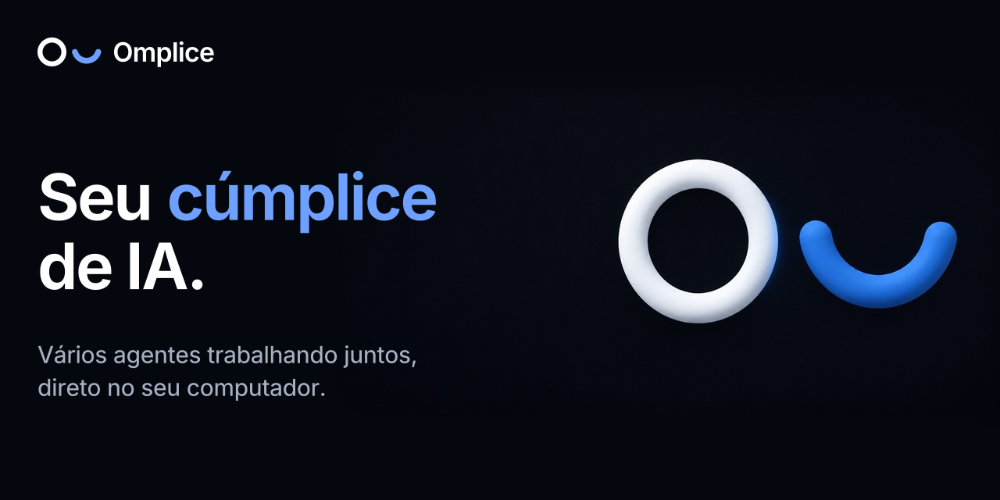

<h3>O agente de IA que trabalha dentro do seu computador.</h3>

<p>Ele roda comandos, abre e edita arquivos e mostra na conversa tudo o que fez.<br>
Você pede, confere e fica com o crédito.</p>

<a href="https://github.com/edevbr/omplice/releases/latest"></a>&nbsp;<a href="https://github.com/edevbr/omplice/releases"></a>

<br>

<a href="https://github.com/edevbr/omplice/releases/latest"></a>&nbsp;&nbsp;
<a href="https://github.com/edevbr/omplice/releases/latest"></a>&nbsp;&nbsp;
<a href="https://github.com/edevbr/omplice/releases/latest"></a>

<sub>Windows 10 e 11 &nbsp;·&nbsp; Linux 64 bits &nbsp;·&nbsp; Android 8 ou mais novo &nbsp;·&nbsp; Atualização automática e assinada</sub>

<br><br>

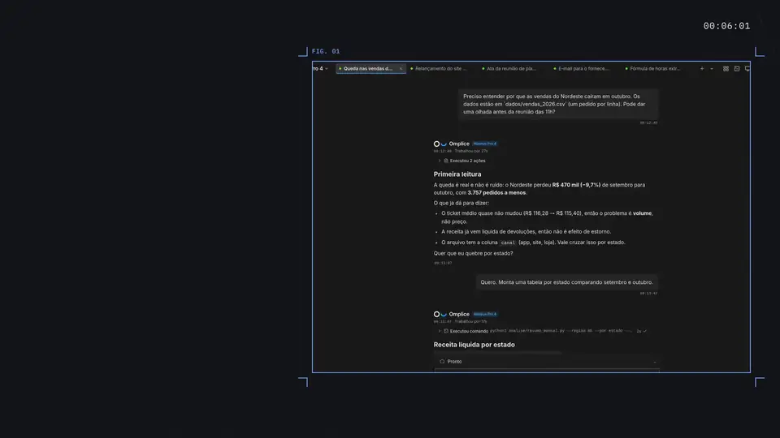

</div>

<br>

## Por que o Omplice

<table>
<tr>
<td width="33%" valign="top">

**Faz o serviço**

Não fica só na resposta. Lê os seus arquivos, roda o que precisa e entrega tabela, gráfico ou código na própria conversa.

</td>
<td width="33%" valign="top">

**Nada pelas suas costas**

Cada comando aparece enquanto roda. O que mexe no seu computador espera o seu sim, e você pode parar tudo quando quiser.

</td>
<td width="33%" valign="top">

**Com os seus modelos**

Use os modelos que você já assina, com as suas contas e chaves, e troque de modelo no meio da conversa.

</td>
</tr>
</table>

## Recursos

<table>
<tr>
<td width="50%" valign="top">
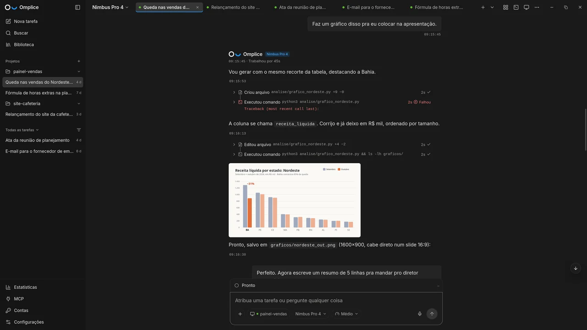

### Você pede, ele faz

Peça como pediria a um colega. Ele lê os arquivos, roda o que precisa e mostra o resultado na conversa.

</td>
<td width="50%" valign="top">
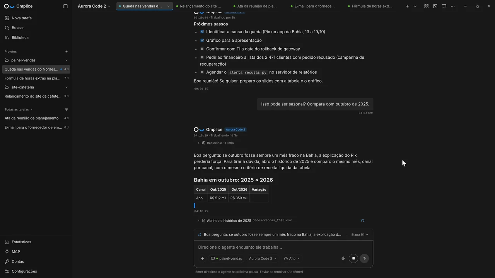

### Ao vivo, passo a passo

Cada comando aparece enquanto roda, e as edições viram um diff colorido enquanto o modelo escreve. Mensagem nova entra na fila e pode ser enviada na hora.

</td>
</tr>
<tr>
<td width="50%" valign="top">
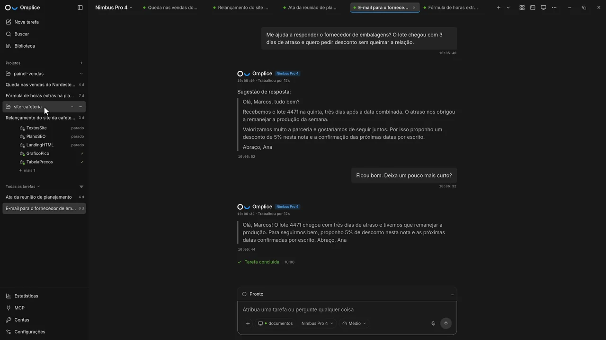

### Uma aba para cada serviço

Cada tarefa fica na sua aba e várias andam ao mesmo tempo. Os projetos são as suas pastas, e o histórico fica onde você deixou.

</td>
<td width="50%" valign="top">
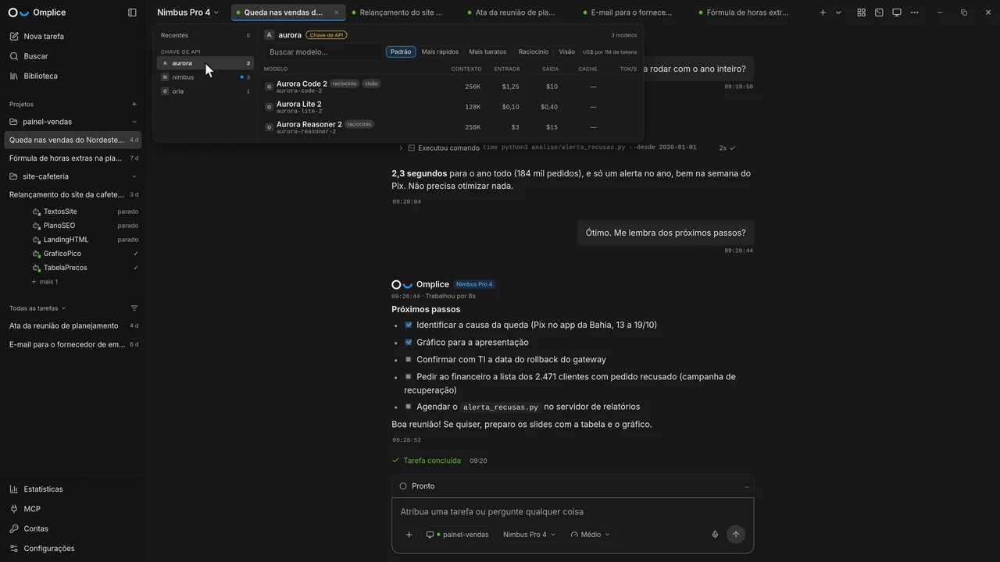

### Troca de cérebro no meio do caminho

Modelos de vários provedores, com as suas contas e chaves. Dá para trocar de modelo e de nível de raciocínio sem sair da conversa.

</td>
</tr>
<tr>
<td width="50%" valign="top">
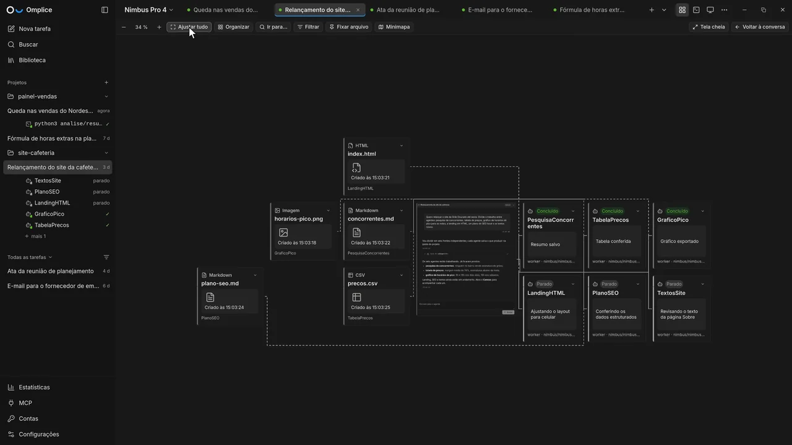

### Serviço grande? Ele chama reforço

Divida um pedido entre vários agentes. O Canvas mostra quem está fazendo o quê, os arquivos que saíram e a prévia do resultado.

</td>
<td width="50%" valign="top">
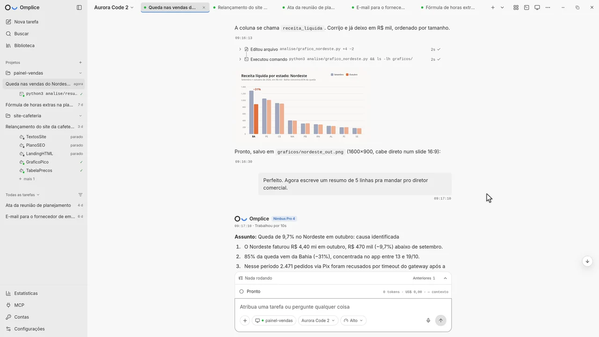

### Do seu jeito

Tema claro, escuro ou o do sistema. Aparência, modelos, atalhos e voz ficam num lugar só, com busca. Dá para ditar o pedido e mandar imagens.

</td>
</tr>
</table>

### No celular

<table>
<tr>
<td width="56%" valign="middle">

O app Android continua as conversas do computador. Acompanhe o trabalho, aprove comandos e troque de modelo de onde estiver.

O pareamento é por QR, e o app do computador precisa estar aberto.

O APK sai em cada lançamento, sempre na mesma versão do app do computador.

</td>
<td width="44%" align="center">
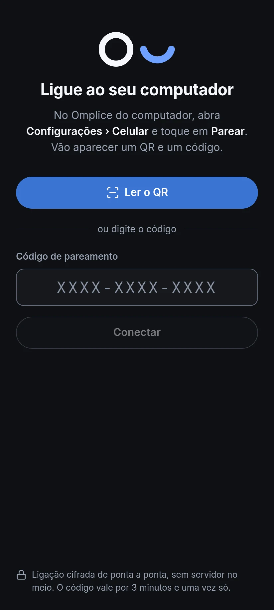&nbsp;
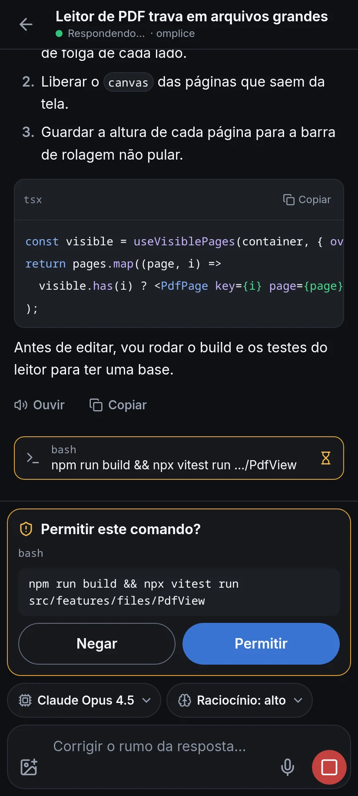&nbsp;
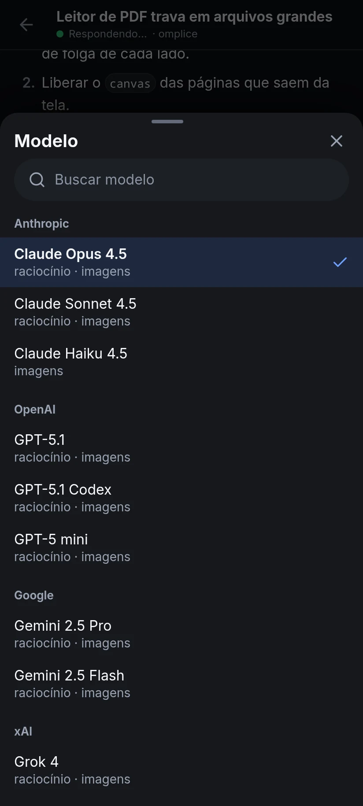
</td>
</tr>
</table>

## Privacidade e segurança

- **Roda no seu computador.** O agente usa as suas contas, e os pedidos vão direto do seu computador para o provedor do modelo que você escolheu. As conversas ficam em arquivos seus.
- **Nada acontece sem o seu sim.** O que mexe no sistema espera a sua aprovação, no computador ou no celular.
- **Celular cifrado de ponta a ponta.** Nenhum servidor no caminho consegue ler o que passa entre o celular e o computador.
- **Atualizações assinadas.** O app só instala uma versão cuja assinatura confere com a chave de lançamento.

## Instalação

| | Windows | Linux | Android |
| --- | --- | --- | --- |
| **Sistema** | Windows 10 ou 11, 64 bits | x86_64 (64 bits) | Android 8 ou mais novo, 64 bits (arm64) |
| **Arquivo** | `Omplice_<versão>_x64-setup.exe` | `Omplice_<versão>_amd64.AppImage` | `Omplice-<versão>-arm64.apk` |
| **Tamanho** | cerca de 120 MB | cerca de 340 MB | cerca de 19 MB |
| **Atualização** | automática | automática | instale o APK novo por cima |

**Windows**

1. Baixe o instalador no [último lançamento](https://github.com/edevbr/omplice/releases/latest).
2. Rode o arquivo. Ele instala o Omplice só para o seu usuário, cria o atalho e, se faltar, instala o WebView2.
3. O instalador ainda não tem assinatura de código da Microsoft, então o SmartScreen pode avisar na primeira vez. Clique em **Mais informações → Executar assim mesmo**.

**Linux**

Baixe a AppImage no [último lançamento](https://github.com/edevbr/omplice/releases/latest) e rode:

```sh
chmod +x Omplice_*_amd64.AppImage
./Omplice_*_amd64.AppImage
```

Se ela não abrir por falta de FUSE, rode com `./Omplice_*_amd64.AppImage --appimage-extract-and-run`.

**Android**

1. No celular, baixe o `Omplice-<versão>-arm64.apk` no [último lançamento](https://github.com/edevbr/omplice/releases/latest).
2. Abra o arquivo. Na primeira vez, o Android pede para permitir a instalação de apps desta origem (o navegador ou o gerenciador de arquivos): permita e volte.
3. No computador, abra o Omplice e leia o QR de pareamento com o app do celular.

Para atualizar, instale o APK da versão nova por cima: as conversas e o pareamento continuam. Use a mesma versão no celular e no computador.

## Atualizações

O Omplice confere se há versão nova ao abrir e a cada 6 horas, baixa em segundo plano e confere a assinatura antes de instalar. A versão nova entra quando o app reinicia, pelo aviso **Reiniciar e atualizar** ou na próxima vez que você abrir. No Windows, o instalador novo roda sozinho, só com uma barra de progresso.

Em **Configurações → Atualizações** você vê a versão instalada e pode checar na hora.

## Perguntas frequentes

<details>
<summary><b>Quais modelos de IA posso usar?</b></summary>
<br>
Os que você já assina, de vários provedores, com as suas contas e chaves. Dá para trocar de modelo e de nível de raciocínio no meio da conversa.
</details>

<details>
<summary><b>Dá para fazer várias coisas ao mesmo tempo?</b></summary>
<br>
Dá. Cada tarefa fica na sua aba, e várias andam ao mesmo tempo. Um serviço grande pode ser dividido entre vários agentes, e o Canvas mostra quem está fazendo o quê.
</details>

<details>
<summary><b>Como eu sei o que o agente está fazendo?</b></summary>
<br>
Cada comando aparece na conversa enquanto roda. O que mexe no seu computador espera a sua aprovação, e dá para parar tudo quando quiser.
</details>

<details>
<summary><b>Posso falar com o agente por voz?</b></summary>
<br>
Pode. Você dita o pedido em vez de digitar. Também dá para mandar imagens na conversa.
</details>

<details>
<summary><b>O que é o omp?</b></summary>
<br>
É o agente por trás do Omplice: o <a href="https://github.com/can1357/oh-my-pi">oh-my-pi</a>, de código aberto (licença MIT). O Omplice é o app de computador feito em volta dele, com conversa, abas, Canvas e celular.
</details>

<details>
<summary><b>Onde está o código-fonte?</b></summary>
<br>
Não neste repositório. Aqui ficam só as versões compiladas e assinadas do app.
</details>

## Onde as versões saem

Cada versão é compilada, assinada e publicada automaticamente, ao mesmo tempo, em dois lugares com os mesmos arquivos:

- **Gitea**: [git.evandro.dev.br/evandro/omplice](https://git.evandro.dev.br/evandro/omplice/releases). É de lá que os apps instalados leem as atualizações.
- **GitHub**: [github.com/edevbr/omplice](https://github.com/edevbr/omplice/releases), espelho.

O Omplice está em desenvolvimento ativo, na série 0.x: as versões saem com frequência e a interface ainda muda.

<br>

<div align="center">

<br>
<sub><b>Omplice</b> · Todo mundo precisa de um cúmplice.</sub>
</div>
